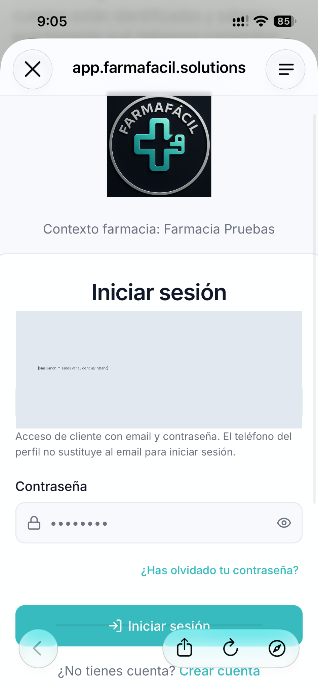
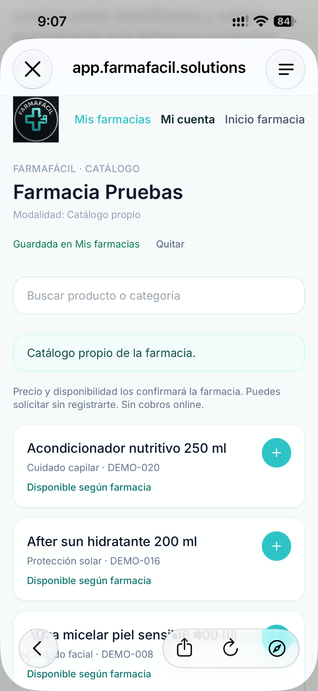
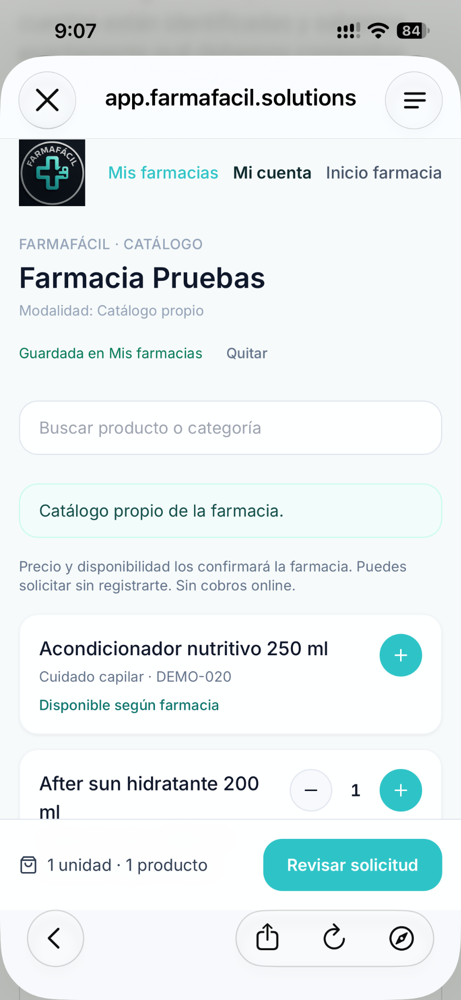
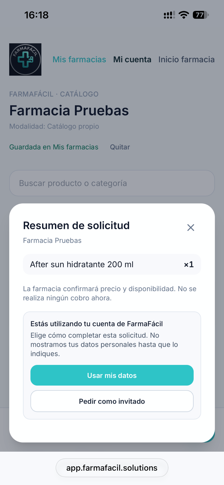
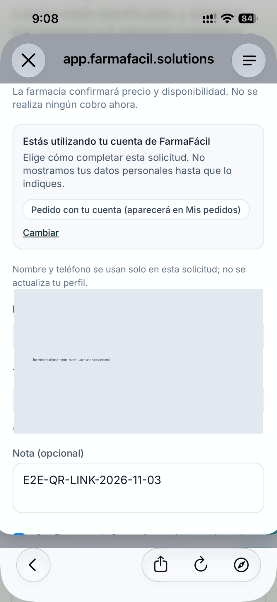
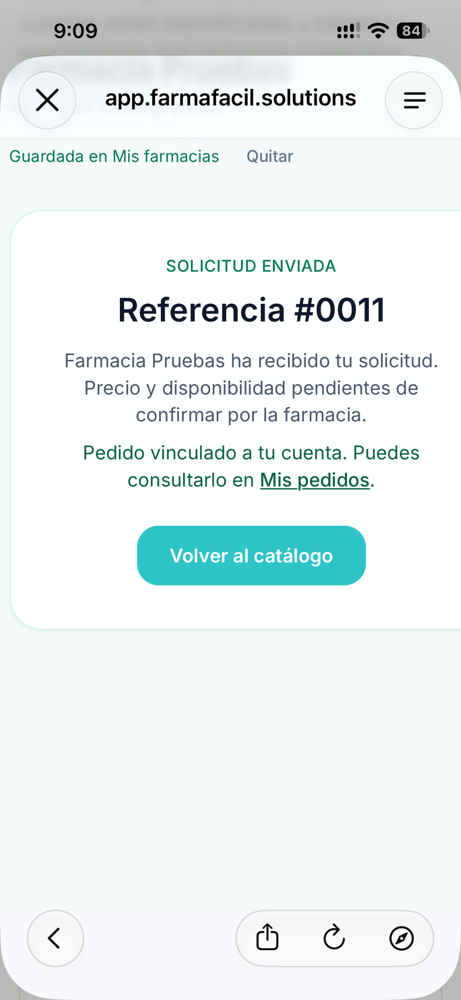
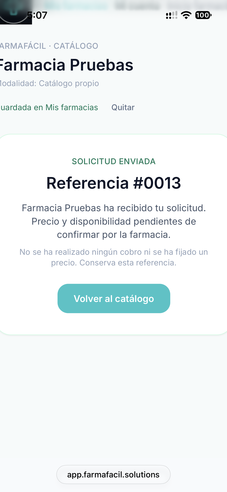
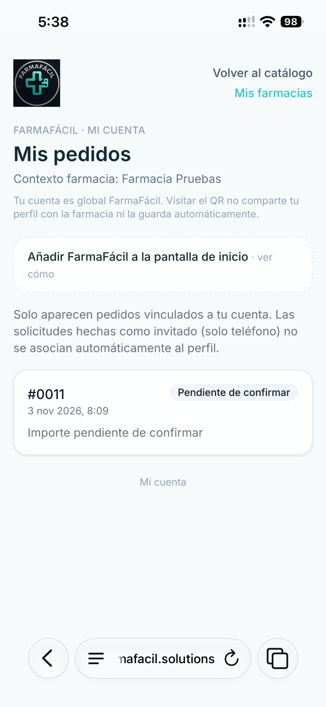
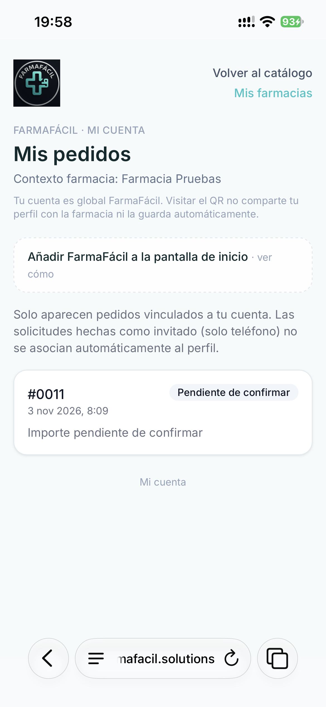

# Manual de usuario — Cliente (pilotos)

**Versión documentada:** producción `https://app.farmafacil.solutions`  
**Baseline:** `origin/main` (PR #13 etiquetas Mis pedidos).  
**Audiencia:** clientes finales (QR, web, PWA).  
**Índice:** [INDICE_PANTALLAS.md](INDICE_PANTALLAS.md) · **Pruebas:** [../pruebas/PLAN_MAESTRO_PRUEBAS.md](../pruebas/PLAN_MAESTRO_PRUEBAS.md)

Solo funcionalidades **publicadas**. Lo pendiente de prueba está al final.

> Use `publicId` en `/e/[publicId]/…`. El panel profesional `/f/[pharmacyId]/…` no es para clientes.

**Capturas (anonimizadas para documentación):** [capturas/cliente/](capturas/cliente/) · [capturas/historico/](capturas/historico/)  
**Originales con PII (solo equipo):** `docs/pruebas/evidencias/interno/` (**excluido de Git** vía `.gitignore`)  
**SQL anonimizado:** [../pruebas/evidencias/sql/](../pruebas/evidencias/sql/)

**Control de versiones:**

| Ámbito | Estado |
|---|---|
| Pedido QR «Usar mis datos» (#0011) | Probado en producción |
| Pedido QR invitado con sesión (#0013) | Probado — no vincula a Mis pedidos |
| Etiquetas Mis pedidos | Corregidas y verificadas (INC-QR-001/002) |
| Valoración / preparación / cobro / entrega | Pendiente de prueba |

---

## 1. Registro

SCR-CLI-003 / SCR-CLI-007 · **TC-CLI-001**

## 2. Confirmación de email

**TC-CLI-002**

## 3. Inicio de sesión

SCR-CLI-006 · **TC-CLI-003**

1. Abrir `/e/[publicId]/cuenta/entrar`.  
2. Email y contraseña.  
3. **Iniciar sesión**.

## 4. Recuperación de contraseña

**TC-CLI-004**

## 5. Hub, perfil y cuenta en farmacia

| Sección | Pantalla | Prueba | Captura |
|---|---|---|---|
| Hub PWA | SCR-CLI-001 | TC-CLI-010 | — |
| Cuenta contextual | SCR-CLI-005 | TC-CLI-012 | [cuenta](capturas/cliente/SCR-CLI-005_cuenta_farmacia_prod.png) |
| Perfil | SCR-CLI-008 | TC-CLI-011 | — |

## 6–9. Direcciones, Mis farmacias, QR, catálogo

SCR-CLI-009 · SCR-CLI-004 · SCR-PUB-001 · SCR-PUB-002  

---

## 10. Dos modos de solicitud QR (con sesión)

| Modo | Mis pedidos | Panel farmacia | Prueba | Evidencia |
|---|---|---|---|---|
| **Usar mis datos** | Sí | Sí | TC-CLI-030 · #0011 | Confirmación + Mis pedidos + SQL |
| **Pedir como invitado** | No | Sí | TC-CLI-031 · #0013 | Confirmación + ausencia Mis pedidos + SQL |

### 10.1 «Usar mis datos» (#0011)

SQL: [SQL-0011_vinculado_anonimizado.txt](../pruebas/evidencias/sql/SQL-0011_vinculado_anonimizado.txt)

### 10.2 «Pedir como invitado» (#0013)

SQL: [SQL-0013_invitado_anonimizado.txt](../pruebas/evidencias/sql/SQL-0013_invitado_anonimizado.txt)

---

## 11. Mis pedidos

SCR-CLI-010 · **TC-CLI-032**

- **Pendiente de confirmar** / **Importe pendiente de confirmar** en #0011.  
- El #0013 (invitado) **no** aparece.  
- Histórico INC: [antes corrección](capturas/historico/SCR-CLI-010_mis_pedidos_0011_antes_correccion.png) · [preview rama](capturas/historico/SCR-CLI-010_mis_pedidos_0011_corregido_preview_rama.png)

---

## 12–13. PWA y privacidad

**TC-CLI-040/041** · **TC-CLI-050**

---

## Pendiente

| Tema | Estado |
|---|---|
| Valoración / confirmación importe / preparación / cobro / entrega | Pendiente E2E |
| TC-CLI-033 token invitado | Pendiente |
| Redacción manual fina de PNG públicos (si se requiere pixel-perfect) | Bandas aplicadas; originales en `evidencias/interno` |
