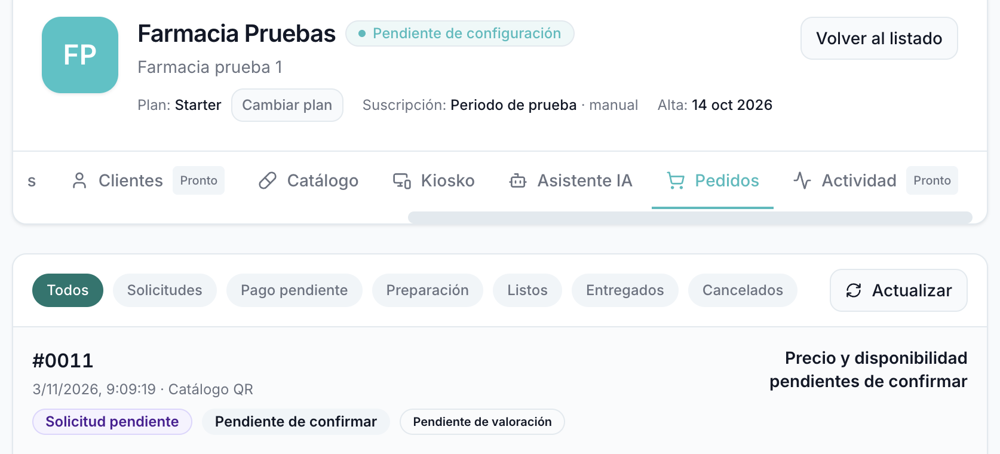
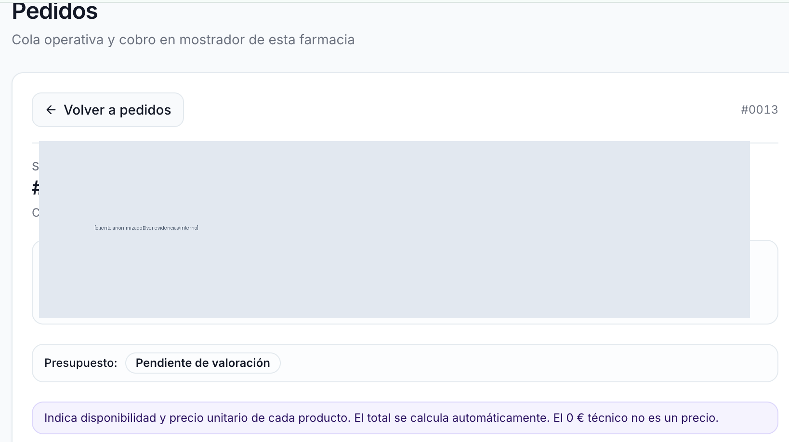

# Manual de usuario — Farmacia (pilotos)

**Versión documentada:** producción `https://app.farmafacil.solutions`  
**Baseline:** `origin/main` · pruebas QR E2E-F: 03–05/11/2026.  
**Audiencia:** personal de farmacia (titular / administrador / farmacéutico / empleado).  
**Índice:** [INDICE_PANTALLAS.md](INDICE_PANTALLAS.md) · **Pruebas:** [../pruebas/PLAN_MAESTRO_PRUEBAS.md](../pruebas/PLAN_MAESTRO_PRUEBAS.md)

Este manual describe **solo funcionalidades disponibles en producción**. Lo no publicado o no probado está al final, en *Pendiente de publicación o validación*.

**Capturas (anonimizadas):** [capturas/farmacia/](capturas/farmacia/)  
**Originales con PII:** `docs/pruebas/evidencias/interno/` (solo equipo local; **excluido de Git** vía `.gitignore`)  
**SQL:** [../pruebas/evidencias/sql/](../pruebas/evidencias/sql/)

**Control de versiones:**

| Ámbito | Estado |
|---|---|
| Localizar solicitudes QR en Pedidos (vinculada e invitada) | **Probado en producción** (#0011, #0013 · Farmacia Pruebas) |
| Acceso multifarmacia (invitar → aceptar → selector → pedidos farmacia activa) | **Parcial 2026-11-05** — TC-FAR-073; capturas MULTI reservadas; cambio 2ª farmacia / rol Empleado / RLS **pendiente** |
| Valoración de precios, confirmación de importe, preparación, cobro, entrega | **Pendiente de prueba** — no inventar pasos |

## Roles (producción)

| Rol | Nombre habitual | Gestiona usuarios |
|---|---|---|
| `PHARMACY_OWNER` | Titular | ADMIN, PHARMACIST, STAFF |
| `PHARMACY_ADMIN` | Administrador | PHARMACIST, STAFF |
| `PHARMACIST` | Farmacéutico | No |
| `STAFF` | Empleado | No |

---

## 1. Acceso y recuperación de contraseña

### 1.1 Iniciar sesión

| | |
|---|---|
| **Objetivo** | Entrar al panel |
| **Pantalla** | SCR-AUTH-001 `/login` |
| **Captura** | Captura pendiente — obtener en local/preview con usuario de prueba; anonimizar email |
| **Prueba** | TC-FAR-001 |

**Requisitos:** usuario invitado y activo.

**Pasos:** 1) Abrir `/login`. 2) Email y contraseña. 3) Enviar. 4) Si aplica, elegir farmacia (SCR-AUTH-008) o aceptar invitaciones (SCR-AUTH-007).

**Resultado esperado:** `/f/[pharmacyId]/dashboard`.

**Errores habituales:** contraseña incorrecta; invitación pendiente; farmacia no operable.

### 1.2 Primer acceso (invitación)

SCR-AUTH-004 / SCR-AUTH-006 · **Prueba** TC-FAR-002 · **Captura pendiente**  
Abrir enlace del correo, definir contraseña si se pide y aceptar membresía.

### 1.3 Recuperar contraseña

SCR-AUTH-002 → SCR-AUTH-003 · **Prueba** TC-FAR-003 · **Captura pendiente**  
«¿Olvidaste tu contraseña?» en login → correo → nueva contraseña.

### 1.4 Acceso multifarmacia (en curso · 2026-11-05)

SCR-AUTH-007 · SCR-AUTH-008 · SCR-FAR-002 · **Prueba** TC-FAR-073 (reutiliza TC-FAR-070 para invitar; aislamiento pendiente vía TC-ISO-003)

**Contexto observado en producción:** usuario propietario de **Farmacia Total PRO** con invitación pendiente a **Farmacia Pruebas Producción** como **Empleado**.

| Paso | Observación | Estado |
|---|---|---|
| Invitación pendiente visible | Sí | Observado |
| Tras aceptar: selector con ambas farmacias y roles | Sí | Observado |
| Pedidos de Farmacia Total PRO sin mezclar otras | Sí (UI) | Observado |
| Cambio a la segunda farmacia | — | **Pendiente** |
| Restricciones del rol Empleado | — | **Pendiente** |
| Aislamiento de datos en servidor | — | **Pendiente** |

**Capturas reservadas (PNG aún no incorporados — no inventar archivos):**

- `capturas/farmacia/SCR-FAR-MULTI-001_invitacion_pendiente.png`
- `capturas/farmacia/SCR-FAR-MULTI-002_selector_farmacias.png`
- `capturas/farmacia/SCR-FAR-MULTI-003_selector_panel.png`
- `capturas/farmacia/SCR-FAR-MULTI-004_pedidos_farmacia_activa.png`

**Resultado esperado al cerrar la prueba:** el selector lista solo farmacias autorizadas con el rol correcto; al entrar en una, Pedidos y el resto del panel muestran solo datos de esa farmacia; el rol Empleado no otorga capacidades de OWNER/ADMIN.

---

## 2. Dashboard

SCR-FAR-001 · **Prueba** TC-FAR-010 · **Captura pendiente**

**Objetivo:** resumen del día y accesos a pedidos, catálogo y dispositivos.  
**Resultado esperado:** datos coherentes con la actividad de la farmacia.

---

## 3. Gestión de pedidos

SCR-FAR-002 · **Prueba** TC-FAR-020 (permisos STAFF: TC-FAR-021)

**Objetivo:** localizar solicitudes recibidas desde el catálogo QR (y otros orígenes).

### 3.1 Localizar solicitudes QR (probado en E2E-F)

Las solicitudes del catálogo QR llegan al mismo listado de **Pedidos**, tanto si el cliente usó **«Usar mis datos»** como si pidió **como invitado**.

| Referencia | Origen | Panel farmacia | Captura |
|---|---|---|---|
| **#0011** | QR · «Usar mis datos» | Visible |  |
| **#0013** | QR · invitado | Visible |  |

SQL: [SQL-0011](../pruebas/evidencias/sql/SQL-0011_vinculado_anonimizado.txt) · [SQL-0013](../pruebas/evidencias/sql/SQL-0013_invitado_anonimizado.txt)

**Pasos probados (localización):**

1. Iniciar sesión en el panel (`/login` → `/f/[pharmacyId]/…`).
2. Abrir **Pedidos**.
3. Buscar por número de pedido (`#0011`, `#0013`, …).
4. Abrir el detalle si la UI lo permite para ver líneas y origen.

**Resultado esperado:** la solicitud QR figura en el listado de **esa** farmacia.

**Qué no está probado aún (no documentar como procedimiento cerrado):**

- Valoración de precios / líneas.  
- Confirmación de importe.  
- Paso a preparación / listo / entregado.  
- Cobro o cambio de estado de pago.  
- WhatsApp u otras notificaciones.

**Errores habituales:** sin permiso de gestión; confundir farmacias; asumir que un pedido invitado debe salir en Mis pedidos del cliente (no debe).

---

## 4. Catálogo y stock

SCR-FAR-003 · **Prueba** TC-FAR-030 · **Captura pendiente**

**Pasos:** buscar/filtrar → editar visibilidad, datos o stock → guardar.  
**Resultado esperado:** cambio visible en catálogo QR/kiosko según configuración.

---

## 5. Importación Excel

SCR-FAR-003 (diálogo import) · **Prueba** TC-FAR-031 · **Captura pendiente**

**Requisitos:** catálogo en modo propio (`own`).  
**Pasos:** importar → revisar válidas/errores → confirmar.  
**Errores:** columnas incorrectas; modo genérico sin import propia.

---

## 6. Estadísticas

Resumen en el dashboard (SCR-FAR-001). **Prueba** TC-FAR-011. No hay módulo de analítica avanzada publicado.

---

## 7. Activación y vinculación de kiosko

SCR-FAR-009 · pairing SCR-KSK-001 · **Pruebas** TC-FAR-050, TC-KSK-001 · **Captura pendiente**

**Requisitos:** módulo kiosko activo.

**Pasos:** 1) Dispositivos. 2) Generar código. 3) En la tablet, `/k/pair` e introducir código.

**Resultado esperado:** dispositivo listado; `/k` muestra bienvenida.

**Uso en sala:** SCR-KSK-002…005. Iconos de tiles (referencia de producto, no captura de pantalla): [capturas/kiosko/referencia-assets/](capturas/kiosko/referencia-assets/).

---

## 8. Configuración

SCR-FAR-010 · **Prueba** TC-FAR-060 · **Captura pendiente**  
Revisar datos de farmacia y, si el rol lo permite, resumen de suscripción/módulos.

---

## 9. Gestión de usuarios

SCR-FAR-008 · **Pruebas** TC-FAR-070…072 · **Captura pendiente**  
Solo OWNER/ADMIN. Invitar roles permitidos; no crear OWNER desde ADMIN; no suspenderse a sí mismo.  
Si el invitado ya es OWNER de otra farmacia, el flujo de aceptación + selector se documenta en **§1.4** (TC-FAR-073).

---

## 10. Asistente IA

SCR-FAR-006 / SCR-FAR-007 · **Pruebas** TC-FAR-080, TC-FAR-081 · **Captura pendiente**  
Solo si el módulo está contratado. Configurar mensajes/FAQs y atender consultas. Si el entitlement está apagado, la pantalla lo indica.

---

## Pendiente de publicación o validación (no usar en piloto como disponible)

| Tema | Estado | Notas |
|---|---|---|
| Valoración de precios / confirmación de importe | Pendiente de prueba E2E | Tras creación QR (#0011/#0013) |
| Preparación → listo → entrega | Pendiente de prueba E2E | |
| Cobro / estados de pago | Pendiente de prueba E2E | |
| Clientes (SCR-FAR-004) | placeholder | ModulePlaceholder |
| Ofertas/promociones (SCR-FAR-005) | placeholder | ModulePlaceholder |
| Impresión física de ticket | APK Android no en `origin/main` | Ver captura desarrollo USB: `capturas/kiosko/desarrollo/FUT-ANDROID_diagnostico-usb.jpg` (**DESARROLLO**) |
| Mockup bienvenida tablet | mockup | `capturas/kiosko/desarrollo/MOCKUP_…` — **no es captura real** |

**Limitaciones conocidas en producción:** sin módulo clientes/promos; listado SA de pedidos es otro rol/placeholder. Pedidos de prueba #0011 y #0013 se conservan (no borrar).
