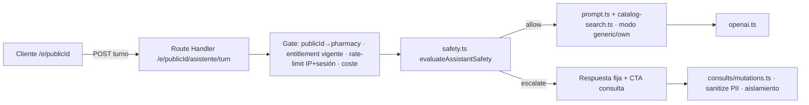

# Propuesta 4.1 — Asistente en el área de cliente (`/e/…`) · SOLO DISEÑO

- **Fecha:** 2026-11-23 · **Estado:** propuesta (autorizada para diseño; **no se implementa nada**).
- **Origen:** hallazgo #9 de `DIAGNOSTICO_QA_2026-11-23.md` — el asistente no aparece en el área pública del cliente.
- **Alcance de este documento:** decisiones, arquitectura, riesgos y plan por fases. Sin código, sin migraciones, sin cambios de flags.

## 1. Situación actual (hechos verificados en el repo)

| Superficie | Asistente | Dónde vive |
|---|---|---|
| Kiosko tablet | Sí | `app/k/asistente/*`, `lib/kiosk/assistant/*` |
| Panel farmacia | Configuración + bandeja de consultas | `app/f/[pharmacyId]/asistente/*` (`actions.ts`, `consultas/`) |
| Área pública cliente `/e/<publicId>` | **No** (solo catálogo + cuenta) | `app/e/[publicId]/page.tsx`, `/catalogo`, `/cuenta/*` |

Piezas reutilizables ya existentes:

- **Entitlement** `assistant_ai` por farmacia (`pharmacy_entitlements`, `lib/kiosk/assistant/entitlement*.ts`): estados
  trial/activo/expirado y política de acciones (`entitlement-actions-policy.ts`). Fase7 tiene `assistant_ai=trial` hasta 2026-12-13.
- **Seguridad**: `safety.ts` (derivación a farmacéutico/112 ante dosis, interacciones, embarazo, receta, urgencias).
- **Anti-abuso**: `rate-limit.ts`, `consults/rate-limit-policy.ts`, `cost.ts` (control de coste), `turn-gates.ts`.
- **Contexto**: `catalog-search.ts` y `prompt.ts` (catálogo de la farmacia, modo `generic`/`own`), `settings.ts` (contenido/horarios).
- **Consultas al farmacéutico**: `consults/*` (sanitiza PII, aislamiento por farmacia, `isolation-policy`).

## 2. Objetivo y no-objetivos

**Objetivo:** que un cliente que llega por QR (con o sin cuenta) pueda hacer preguntas de orientación sobre el catálogo y la
farmacia, y enviar una **consulta al farmacéutico**, con las mismas garantías de seguridad que el kiosko.

**No-objetivos (explícitos):**

- No diagnosticar, indicar dosis ni valorar casos clínicos (se mantiene derivación).
- No tomar pedidos ni modificar el carrito desde el chat en v1 (solo «ver en catálogo»).
- No activar el asistente en farmacias sin entitlement vigente; **no habilitar global**.
- No compartir historial de chat con la farmacia ni persistirlo con identidad del cliente en v1.

## 3. Decisiones de producto a confirmar (bloqueantes)

| # | Pregunta | Recomendación |
|---|---|---|
| D1 | ¿Visible para anónimos o solo con cuenta? | **Anónimo permitido con límites estrictos**; cuenta eleva límites y habilita «consulta al farmacéutico» |
| D2 | ¿Solo si la farmacia tiene entitlement `assistant_ai` vigente? | **Sí**. Sin entitlement → no se renderiza el botón (no «upsell» al cliente) |
| D3 | ¿Mismo asistente que el kiosko o una variante «móvil»? | Mismo motor y política de seguridad; **prompt/UX propios** (pantalla pequeña, sin voz/kiosko) |
| D4 | ¿Modo `generic` (sin precios/stock)? | Responder solo tipos genéricos y «confirmar en farmacia»; **nunca** inventar PVP/stock (ya lo impone `catalog-display.ts`) |
| D5 | ¿Quién ve las consultas? | Bandeja existente `/f/[id]/asistente/consultas` (roles con permiso actual) |
| D6 | ¿PHARMACIST puede editar contenido del asistente? | Decisión ligada a la matriz de permisos (pregunta #7 del diagnóstico); **no bloquea** esta propuesta |

## 4. Diseño funcional (UX)

1. **Punto de entrada:** botón flotante «Pregunta al asistente» en `/e/<id>` y `/e/<id>/catalogo`, solo si el gate (§5) es OK.
   Respeta safe-area inferior; no tapa el carrito (el carrito ya usa `pb-[max(1rem,env(safe-area-inset-bottom))]`).
2. **Panel de chat** (bottom sheet en móvil, panel lateral en escritorio): mensaje de bienvenida con aviso permanente
   «No sustituye al farmacéutico. No introduzcas datos personales».
3. **Respuestas con tarjetas de producto** que enlazan a `/e/<id>/catalogo?q=…` (sin añadir al carrito desde el chat en v1).
4. **Derivación:** ante `escalate_pharmacist` se ofrece «Enviar consulta al farmacéutico» (requiere cuenta o teléfono, según
   política actual de consultas) y se muestra el texto de `PHARMACIST_ESCALATION_REPLY`; ante `escalate_emergency` solo el texto 112.
5. **Estados vacíos/errores:** asistente no disponible (entitlement caducado), límite alcanzado, fallo del proveedor → mensajes
   neutros que remiten al mostrador/catálogo.

## 5. Arquitectura propuesta

- **Resolución de farmacia:** `resolvePublicEntrypoint(publicId)` (ya usado en `/e`). El `pharmacy_id` **nunca** viene del cliente.
- **Gate de entitlement:** reutilizar `getAssistantEntitlement` + `entitlement-actions-policy` (misma fuente de verdad que kiosko).
- **Transporte:** Route Handler/Server Action propio de `/e` (no reutilizar la sesión de dispositivo del kiosko; el cliente no tiene
  `kiosk_device`). Requiere una RPC pública `SECURITY DEFINER` mínima o service role en servidor con filtros por `pharmacy_id`
  (decisión técnica en Fase 1; ver riesgos).
- **Historial:** solo en memoria del cliente (`history.ts` ya limita turnos); no se envía a BD. Consultas al farmacéutico sí persisten
  (con sanitización).
- **Telemetría de coste:** contadores por farmacia y por día (`cost.ts`) con tope duro; alerta a SA.

## 6. Seguridad y privacidad

| Riesgo | Mitigación |
|---|---|
| Abuso/costes por anónimos | Rate limit por IP + cookie de sesión + tope diario por farmacia; captcha/turnstile si se supera umbral |
| Fuga entre farmacias | `pharmacy_id` derivado de `publicId` en servidor; `isolation-policy` + tests de aislamiento |
| Consejo clínico | `safety.ts` antes del modelo + instrucciones de sistema; sin ficha de medicamentos con receta |
| PII en prompts | `sanitizeConsultClientMessage`; no enviar email/teléfono/nombre del perfil al proveedor |
| Prompt injection desde catálogo | Catálogo como datos delimitados, nunca como instrucciones; truncado de campos |
| RGPD | Aviso de uso de IA; sin perfilado; retención 0 para chat, consultas según política farmacia; añadir al anexo de encargo (`legal/contracts/anexo-encargo`) |
| PWA/caché | Rutas del asistente fuera de la caché del Service Worker (`sw-customer.js` no cachea HTML ni API) |

## 7. Plan por fases (cuando se autorice implementar)

| Fase | Entregable | Criterio de salida |
|---|---|---|
| 0 | Decisiones D1–D6 + revisión legal del aviso IA | Documento firmado por producto |
| 1 | Endpoint público con gate (entitlement, rate-limit, coste) **sin UI**, tests unitarios de gate y aislamiento | `node --test` verde; pruebas manuales en Fase7 (entitlement trial) |
| 2 | UI móvil (bottom sheet) tras feature flag **por farmacia**, solo Fase7 | E2E P1 en Fase7; revisión visual iOS/Android |
| 3 | Consulta al farmacéutico desde `/e` + bandeja existente | Prueba de aislamiento entre farmacias |
| 4 | Observabilidad (coste, tasa de derivación) y apertura gradual | Informe de QA y OK de SA Total |

## 8. Pruebas previstas

- Unitarias: gate de entitlement (activo/trial/expirado/ausente), rate-limit anónimo vs cuenta, saneado PII, derivación safety.
- Integración (staging): Fase7 con trial vigente → disponible; farmacia sin entitlement (Piloto Integral) → botón ausente.
- E2E (Playwright): `/e/2mo6cq0yjss6ratr` muestra el asistente; `/e/8132f4yiijl5igfr` no; límite de mensajes.
- Seguridad: intento de forzar `pharmacy_id` ajeno; inyección en nombre de producto; ráfaga de peticiones anónimas.

## 9. Impacto y estimación (orientativa)

- Reutiliza ≈80 % de `lib/kiosk/assistant/*`. Trabajo nuevo: endpoint público + gate anónimo, UI móvil, tests.
- Migración probable: 1 RPC pública o policy mínima (a definir en Fase 1; **no** implica tocar migración 105 ni producción).
- Esfuerzo: ~2–3 semanas persona para Fases 1–3, más revisión legal en paralelo.

## 10. Fuera de alcance / pendiente

Voz, pedidos desde el chat, memoria entre sesiones, personalización por cliente, y cualquier activación en producción.
