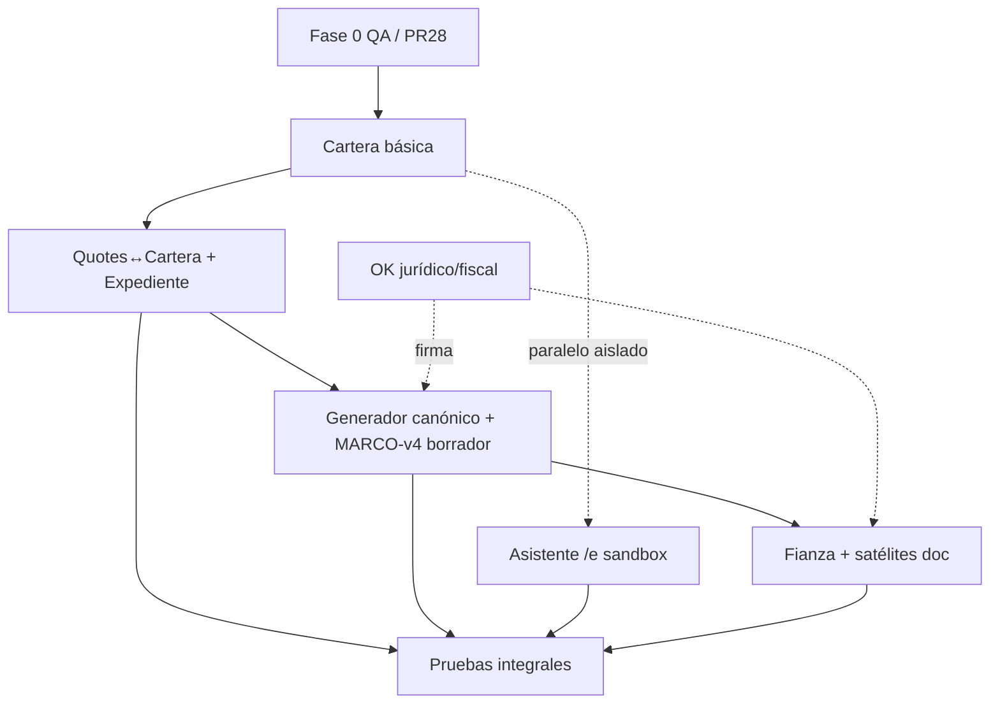

# Plan maestro de consolidación funcional y documental — FarmaFácil

**Fecha:** 2026-11-24 · **Actualizado:** 2026-11-25 (aceptación manual STAGING)  
**Estado:** plan de diseño y ejecución aprobado funcionalmente · **no autoriza** migraciones, merge, deploy ni implementación de la reorganización SuperAdmin  
**Fuentes aprobadas (con ajustes):**  
`AUDITORIA_SISTEMA_DOCUMENTAL_FARMAFACIL.md` · `PROPUESTA_ASISTENTE_AREA_CLIENTE_2026-11-23.md` · `PROPUESTA_CARTERA_VS_FARMACIAS_2026-11-23.md` · decisiones funcionales SuperAdmin (aceptación 2026-11-25) · `REQUISITOS_FUNCIONALES_SUPERADMIN_REORG_CATALOGOS_RENTABILIDAD_2026-11-25.md`

---

## Resumen ejecutivo

Objetivo: consolidar trabajo existente y preparar **pilotos de diciembre** sin duplicidades, ramas incompatibles ni regresiones.

| Para los primeros pilotos (imprescindible) | Para contratación comercial definitiva (posterior) |
|--------------------------------------------|-----------------------------------------------------|
| Cierre QA / PR #28 cuando se autorice | FF-MARCO-v4 jurídicamente aprobado + firma |
| Cartera básica + importación controlada | Fianza operativa + justificantes/liquidaciones |
| Presupuestos ligados a Cartera (antes de tenant) | Expediente completo (actas, SEPA, anexo) |
| Creación explícita de farmacia sin trial | Emisión definitiva / cobros reales |
| Generador PDF canónico estable en staging | DOCX canónico si se mantiene |
| Emails con dry-run / allowlist / `[PRUEBA STAGING]` | Campañas (sigue prohibido) |
| Asistente cliente solo en entorno aislado + gates | Consultas sanitarias reales post-revisión privacidad |

---

## 1. Decisiones funcionales consolidadas

### 1.1 Cartera (opción B — aprobada)

- Cartera = relaciones comerciales; Farmacias = tenants operativos.
- Cuentas independientes de `pharmacies`; agrupación opcional multi-farmacia sin perder independencia.
- Contactos múltiples, responsable comercial, dirección completa (CP, población, provincia), identificador oficial de oficina cuando exista, datos fiscales opcionales.
- Origen, encuesta (+ fecha), interés piloto, demo realizada, estado comercial, última/próxima acción, historial, consentimientos con evidencia por canal, motivo rechazo/aplazamiento, archivado lógico.
- Import Excel/CSV: preview, validación, duplicados, actualización controlada. **Email compartido ≠ misma entidad.** Consentimientos **nunca** concedidos por defecto en import.
- Permisos: SA Total completo; SA Comercial = Cartera + comercial autorizado; SA Soporte **sin** Cartera; farmacia/clientes **sin** acceso. Comercial **sin** PII de clientes finales ni ventas operativas.
- Flujo: presupuestos **antes** de tenant; reserva / piloto / contratación = procesos independientes; alta de farmacia explícita, idempotente, sin trial ni activación automática; piloto ≠ «contratada»; historial comercial se conserva; emails solo con base legal validada; **sin** campañas ni envíos masivos reales.

### 1.2 Expediente documental único

- **No** depende solo de `pharmacy_id`. Documentos pre-alta vinculables después a farmacia **sin duplicar**.
- Vínculos: cuenta Cartera, farmacia, presupuesto, reserva, piloto, contrato, kiosko físico, movimiento económico.
- Acceso desde Cartera y ficha Farmacia; permisos por tipo documental.
- Reutilizar `commercial_quotes` y `commercial_contracts`; **una** fuente económica (snapshots).
- Metadatos: versión plantilla, archivo, hash, autor, fecha, estado, envíos, firmas. Bytes emitidos **inmutables**.
- Pestaña **Contrato** actual = operativa/contractual; pestaña **Documentación** = expediente (distintas).

### 1.3 Generadores

- Conservar estética `Referencias_Corporativas`.
- Evaluar HTML/Chromium (INT) vs `fix-quote-print` (pdf-lib + DOCX); **una** arquitectura canónica por tipo.
- No elegir Chromium solo por estética si persisten timeouts staging.
- Recuperar Word si es compatible.

### 1.4 Contratos

- **FF-MARCO-v4** = candidata de trabajo, **no** aprobación jurídica.
- Incorporar al motor existente; conservar v1 para histórico.
- Contenido v4 sin reinterpretar cláusulas; diseño corporativo + es-ES.
- Firma / emisión definitiva / activación **bloqueadas** hasta jurídico + datos proveedor reales (sin inventar CIF/razón/domicilio).

### 1.5 Fianza y economía

- 300 €/kiosko como depósito **separado** del precio; alinear simulador, presupuesto, contrato, inventario, tesorería, justificantes, devolución/liquidación.
- Separar implantación, impuestos, depósito, desembolso inicial, cuotas; multi-kiosko.
- Fiscal/condiciones definitivas pendientes de asesoría.
- No modificar presupuestos aceptados existentes; no justificante sin cobro verificado.

### 1.6 Asistente IA cliente

- Solo con `assistant_ai` vigente y autorizado para canal cliente; anónimo con límites; cuenta obligatoria para consulta a farmacéutico.
- Mismo motor/seguridad que kiosko; UX móvil; sin voz, sin pedidos desde chat, sin memoria persistente del chat ordinario, sin cross-farmacia, sin precios/stock inventados, sin Rx en catálogo comercial.
- Derivación farmacéutico/emergencias; config Owner/Admin; consultas sanitarias solo profesionales autorizados; STAFF sin clínicas.
- Costes conjuntos kiosko/móvil con desglose y alertas SA; auth en servidor cada turno; mínimo privilegio.
- Sin consultas sanitarias reales antes de revisión de privacidad / anexo encargo.

### 1.7 Emails y staging

- Componentes corporativos unificados; adjunto = PDF del expediente.
- Dry-run por defecto, allowlist, prefijo **`[PRUEBA STAGING]`**, validación servidor; sin envíos reales no autorizados.
- Comercial ≠ transaccional.

### 1.8 Reorganización SuperAdmin, catálogos y rentabilidad (2026-11-25)

**Estado:** decisión funcional capturada en aceptación manual STAGING · **pendiente de priorización e implementación** · **no implementado**.

Detalle normativo:  
`docs/qa/share/REQUISITOS_FUNCIONALES_SUPERADMIN_REORG_CATALOGOS_RENTABILIDAD_2026-11-25.md`

#### Menú SuperAdmin (IA)

| Bloque | Contenido acordado |
|--------|--------------------|
| Dashboard | Indicadores comerciales, operativos, económicos, clientes, pedidos agregados, IA, inventario, alertas |
| Farmacias | En marcha · Promociones · Tarifas y simulador |
| Comercial | Cartera · Agenda/Calendly · Presupuestos |
| Proveedores | Material oficina · Kioskos · Software/servicios · Información de productos |
| Gestión App | Inventario kioskos · Clientes · Catálogo (maestro / genérico / personalizados / categorías-subcategorías) |
| Admin. y contabilidad | Contratos · Facturas emitidas/recibidas · Bancos y conciliación |
| Soporte técnico | Incidencias · Historial errores kiosko · Estado de servicios |
| Usuarios y accesos | SA Total · SA Comercial · SA Soporte · Historial de actividad |
| Emails / Configuración / Centro de ayuda | Se mantienen como entradas de primer nivel |

- **Retirar** «Pedidos» como entrada independiente de SA; estadísticas → Dashboard; preservar solo accesos puntuales a pedidos individuales cuando estén autorizados.
- Menú actual plano (`lib/navigation.ts`) **no** refleja aún esta IA; reorganizar en entrega futura.

#### Arquitectura de catálogos (A/B/C)

| Tipo | Rol |
|------|-----|
| **A Genérico** | Parafarmacia genérica (proyección comercial sin PVP inventado) |
| **B Maestro** | Repositorio central (CN, EAN, marca, lab, cat/subcat, descripción, imagen, fuente) |
| **C Personalizado** | Por farmacia: vínculo al maestro + precio, promos y config comercial propia |

- Deduplicar por **CN válido**; EAN fiable si no hay CN; conflictos sin sobrescritura arbitraria.
- Imágenes y clasificación centralizadas; medicamentos fuera de canales públicos de solicitud/venta.
- Stock **opcional y no bloqueante** (política ya aprobada).
- Taxonomía → dentro de Catálogo como **«Categorías y subcategorías»**; UI sin jerga técnica (slug/seed/legacy/active/migraciones).
- **Incidencia a revisar (no código ahora):** aviso UI de migración 089 pendiente vs 089/090 aplicadas en staging en la entrega integrada.

#### Rentabilidad por farmacia

- Nueva pestaña **Rentabilidad** en ficha farmacia · **solo SuperAdmin Total**.
- Captación, implantación, kiosko/materiales, desplazamientos, recurrentes (software/infra/IA), mantenimiento/soporte, ingresos (alta/HW/suscripciones), márgenes, payback, comparativa planes/farmacias.
- Imputación de facturas/gastos a farmacia o prorrateo auditable; separar facturación / cobros / rentabilidad / caja; fianzas ≠ ingresos.
- Integrar con contabilidad, inventario, proveedores, contratos y cartera (reutilizar módulos).

#### Priorización sugerida (post-aceptación)

Tras cerrar QA manual STAGING: (1) IA menú SA + permisos por bloque · (2) modelo catálogos A/B/C + UI categorías · (3) rentabilidad SA Total. Encaja como **Fase 7+** respecto a Fases 0–6 actuales; no desplaza Cartera/expediente/pilotos diciembre salvo re-priorización explícita.

#### Avance E2 ticket / token (2026-11-26)

- Entrega `ENTREGA_QA_KIOSKO_K02_K07_2026-11-26.md`: ticket térmico + `/o/{token}` + mig **105** en staging.
- **Hecho (mínimo):** emisión token opaco en create kiosko, landing estado, QR en ticket (APK pendiente compilar).
- **Pendiente E2 completo:** claim atómico autenticado (`ff_claim_order_by_access_token_v1`), avisos recogida, push. P0 claim-por-teléfono permanece **off**.

---

## 2. Fase 0 — Estado de integración (inventario)

### 2.1 PR abiertos (GitHub, 2026-11-24)

| PR | Título | Base ← Head | Estado |
|----|--------|-------------|--------|
| **#28** | fix(qa): correcciones permisos, pack SA, UX y datos staging | `integration/farmafacil-release` ← `fix/qa-2026-11-23-block1` | OPEN, **MERGEABLE** · +2473/−198 · 2 commits |
| #12 | docs: manuals | `main` ← `docs/manuales-y-pruebas` | OPEN (docs; bajo impacto funcional) |

**No merge automático.** Staging actual ya refleja tip de #28 vía deploy previo; merge a `integration/…` cuando se autorice tras QA manual.

### 2.2 Dependencias de PR #28 y correcciones posteriores

Incluye (ya en tip `6117045`): denegación Usuarios/Kioskos, pack SA-only, `visible_name`, SKUs comerciales, cookie kiosko en sign-out, kit dual + catálogo Piloto + docs QA.

**Posteriores / pendientes (sin merge forzado):**

| Ítem | Relación | Notas |
|------|----------|-------|
| Timeouts PDF presupuesto E2E staging | Post-#28 / infra | Condiciona elección generador (Fase 3) |
| Pack PDF Server Action (propuesta seguridad) | Rama independiente si se autoriza | No redeploy mientras QA manual |
| RPC `visible_name` en kiosk/catálogo (041/055/…) | Migración futura ≠ 105 | No aplicar ahora |
| Docs auditoría / plan maestro / share | Untracked en worktree INT | Solo documentación |
| Seed presupuesto QA contrato | Script staging | Ya aplicado; no tocar datos QA |

### 2.3 Worktrees / ramas relevantes (no exhaustivo de todo el histórico)

| Worktree / rama | Contenido útil | Riesgo si se mergea a ciegas |
|-----------------|----------------|------------------------------|
| `integration-farmafacil-release` / `fix/qa-2026-11-23-block1` | Línea canónica staging + #28 | Base de trabajo |
| `commercial-contracts-v1` | Motor FF-MARCO-v1 | Ya absorbido en INT; no re-merge completo |
| `fix-quote-print` | pdf-lib + DOCX presupuesto | **Alternativa** generador; base antigua (`ab5ab4d`, detrás de main) |
| `cartera-farmacias-import-template` | Stub/plantilla import | Base antigua; **rehacer** sobre INT |
| `commercial-quotes-flow` / `commercial-plans-activation` | Quotes/planes | Parcialmente en INT |
| `emails-phase-*` / `emails-postprod` | Emails | Mayoría en INT; verificar remanentes |
| `pharmacy-lifecycle-directory` | Ciclo vida | Conflicto potencial con Cartera si se revive |
| `launch-seats-manage` | Plazas | Independiente si no toca Cartera |
| Decenas de worktrees QR/kiosk/SA shell | Ya integrados o stale | **Archivar mentalmente**; no reabrir |

**main** (`d07cc1b`): sin motor contratos/quotes vivos; no es base de consolidación comercial.

### 2.4 Conflictos potenciales entre módulos

| Choque | Por qué | Mitigación |
|--------|---------|------------|
| Cartera vs Farmacias | Hoy solo tenants; import “farmacias” confunde | Opción B; alta farmacia explícita |
| Cartera vs Emails | Destinatarios portfolio stub; base legal | Consentimientos + policy; sin masivos |
| Presupuestos vs Cartera | Quotes con `pharmacy_id` nullable ya; falta `portfolio_account_id` | Migración enlace; no segunda economía |
| Contratos vs Documentación | Pestaña Contrato ≠ expediente | Tabs separadas |
| Chromium vs fix-quote-print | Dos PDF presupuestos | Spike Fase 3; un canónico |
| Asistente /e vs kiosko | Coste, RPC, entitlement | Contadores conjuntos; gate servidor |
| Fianza vs quotes aceptados | Snapshot inmutable | Solo quotes nuevos / versión plantilla |

### 2.5 Secuencia de integración única (sin merges auto)

```
0. QA manual + cierre técnico sobre staging actual
1. Autorizar merge PR #28 → integration/farmafacil-release (cuando OK)
2. Congelar base integration como tronco de consolidación
3. Entregas pequeñas desde tronco (Fases 1→6), cherry-pick selectivo
   desde worktrees stale solo tras rebase sobre tronco
4. Promote integration → main solo con go/no-go de lanzamiento
```

**No** crear ramas nuevas innecesarias: preferir `feat/cartera-…`, `feat/dossier-…` etc. **solo** al autorizar cada entrega, desde el tronco actualizado.

Última migración en INT: **104**. **No aplicar 105** (no existe en árbol INT; cualquier mig nueva será numerada tras autorización).

---

## 3. Código existente reutilizable

| Área | Reutilizar |
|------|------------|
| Quotes | `lib/commercial/quote-*`, `quote-actions`, plantilla HTML, snapshots |
| Contratos | `lib/contracts/*`, `legal/contracts/v1`, `/contratos`, `097` |
| PDF | `lib/pdf/html-to-pdf.ts`; evaluar `fix-quote-print` quote-pdf/docx |
| Emails | `corporate-templates`, `send-config` (dry-run), allowlist, compositor |
| Farmacia | `091_create_pharmacy_no_auto_trial`, assign plan 083/093/095, lifecycle |
| Plazas / piloto | launch seats, `pilots-queries`, trials con guards `101` |
| Asistente | `lib/kiosk/assistant/*` (safety, cost, entitlement, consults) |
| Entrypoint público | `resolvePublicEntrypoint` / RPC 098 |
| Import patterns | plantillas CSV existentes (catálogo/cartera stub) como referencia UX |
| Branding | logo circular, teal `#1ABBB3`, es-ES money helpers |

---

## 4. Modelo de datos propuesto (referencia — **no aplicar**)

### 4.1 Cartera

```
commercial_portfolio_accounts
  id, display_name, legal_name?, tax_id?, official_pharmacy_id?
  address_line, postal_code, city, province, country
  stage, source, owner_profile_id
  survey_done, survey_at, interested_pilot, demo_done
  last_action_at, next_action_at, reject_or_defer_reason?
  pharmacy_id?  -- UNIQUE parcial cuando vinculado; conversión explícita
  group_id?     -- agrupación opcional (tabla groups o self-FK)
  archived_at, created_at, updated_at, created_by, updated_by

commercial_portfolio_contacts
  account_id, name, role, email?, phone?, is_primary

commercial_portfolio_consents
  contact_id, channel, purpose, basis, granted_at?, revoked_at?,
  evidence, source  -- nunca granted en import por defecto

commercial_portfolio_events
  account_id, kind, summary, meta jsonb, created_by, created_at

commercial_portfolio_import_batches
  id, filename, stats jsonb, created_by, created_at
```

Permiso: `platform.commercial_portfolio.manage` (SA Total + SA Comercial). Sin DELETE duro.

### 4.2 Expediente (vínculos polimórficos / junction)

```
document_artifacts
  id, kind, template_version, status
  storage_path, content_sha256, byte_size, mime
  created_by, created_at, updated_at
  signed_at?, sent_meta jsonb,  -- trazabilidad envíos
  immutable bool default true when status in (issued, signed)

document_artifact_links
  artifact_id
  portfolio_account_id?
  pharmacy_id?
  quote_id?
  contract_id?
  seat_reservation_id? / pilot_id?
  kiosk_asset_id?
  economic_movement_id?
  -- al menos un link; pharmacy_id puede añadirse después sin clonar artifact
```

**Quotes/contracts:** añadir `portfolio_account_id` nullable; mantener `pharmacy_id` nullable; **no** duplicar breakdown económico.

### 4.3 Fianza (diseño; Fase 5)

```
kiosk_deposits (o economic_movements tipados)
  pharmacy_id / portfolio_account_id?, kiosk_unit_ref
  amount_cents=30000, currency=EUR, status (expected|received|held|returned|forfeited_partial)
  payment_verified_at?  -- gate de justificante
  settlement_artifact_id?
```

### 4.4 Asistente cliente

Sin tablas de chat ordinario. Reutilizar consults + cost counters con dimensión `channel` (`kiosk`|`customer_web`).

### 4.5 Migraciones necesarias (lista; **sin aplicar**)

| Tentativa | Contenido | Fase |
|-----------|-----------|------|
| (post-104) N+1 | portfolio accounts/contacts/consents/events + RLS + permiso | 1 |
| N+2 | `portfolio_account_id` en quotes (+ índice) | 2 |
| N+3 | `document_artifacts` + links + storage policies | 2 |
| N+4 | plantilla contrato v4 versionada en código (sin unlock firma) | 3 |
| N+5 | fianza / movements (tras OK fiscal) | 5 |
| N+6 | assistant cost channel + flags cliente (si hace falta) | 4 |
| ≠ 105 | **prohibida** en esta autorización | — |

Numeración exacta se asigna al autorizar cada entrega.

---

## 5. Dependencias entre módulos



---

## 6. Plan por entregas pequeñas + esfuerzo + aceptación

Estimaciones en **días-persona** (orden de magnitud; 1 dev familiarizado con el repo).

### Fase 0 — Cierre técnico y QA actual · ~1–2 d

| Entrega | Esfuerzo | Criterios de aceptación |
|---------|----------|-------------------------|
| 0.1 Cierre QA-49…70 + informe | Manual (Pilar) + 0.5 | Matriz actualizada; sin redeploy no autorizado |
| 0.2 Decisión merge #28 | 0.5 | Checklist go/no-go; merge solo con OK explícito |
| 0.3 Spike timeouts PDF staging | 0.5–1 | Evidencia Chromium vs límites Vercel |

**Paralelo:** redacción jurídica discrepancias MARCO (sin código).

### Fase 1 — Cartera básica + import · ~5–8 d

| Entrega | Esfuerzo | Aceptación |
|---------|----------|------------|
| 1.1 Schema + RLS + permiso Comercial | 1.5 | SA Comercial OK; Soporte/farmacia denegados; tests RLS |
| 1.2 UI listado/detalle cuenta + contactos + eventos | 2–3 | CRUD archivado; estados; próxima acción |
| 1.3 Import CSV preview/validación/duplicados | 1.5–2 | Email ≠ merge automático; consentimientos no granted |
| 1.4 Conversión explícita → farmacia | 1 | Idempotente; sin trial; stage ≠ won solo por piloto |

**Paralelo tras 1.1:** wireframes Documentación (sin mig).

### Fase 2 — Presupuestos ↔ Cartera + expediente · ~4–6 d

| Entrega | Esfuerzo | Aceptación |
|---------|----------|------------|
| 2.1 `portfolio_account_id` en quotes + UI selección | 1–1.5 | Quote sin pharmacy; link posterior a pharmacy sin clonar |
| 2.2 `document_artifacts` + guardado PDF quote/contract | 2–3 | Hash+versión; reimpresión = bytes guardados |
| 2.3 Tabs Documentación (Cartera + Farmacia) | 1–1.5 | Permisos por kind; Contrato tab intacta |

### Fase 3 — Generadores + MARCO-v4 borrador · ~5–7 d

| Entrega | Esfuerzo | Aceptación |
|---------|----------|------------|
| 3.1 Informe decisión Chromium vs pdf-lib (+DOCX) | 1 | Criterios fiabilidad/Vercel/paginación; un canónico |
| 3.2 Brand kit compartido (header/teal/cards) | 1–1.5 | Presupuesto y contrato borrador misma identidad |
| 3.3 Incorporar texto FF-MARCO-v4 como `v4/` sin unlock | 2–3 | Versión en PDF; v1 histórico; firma sigue bloqueada |
| 3.4 Email adjunto = artifact del expediente | 0.5–1 | Mismo sha; prefijo `[PRUEBA STAGING]` |

**Paralelo:** matriz discrepancias v1↔v4 para jurídico (doc).

### Fase 4 — Asistente cliente aislado · ~4–6 d

| Entrega | Esfuerzo | Aceptación |
|---------|----------|------------|
| 4.1 Gate entitlement + canal + turn API `/e` | 1.5 | Sin entitlement → no UI; auth servidor cada turno |
| 4.2 UX móvil + límites anónimo / consulta con cuenta | 1.5–2 | Sin voz/pedidos/memoria BD chat |
| 4.3 Coste conjunto + alertas SA | 1 | Desglose canal |
| 4.4 Flag entorno aislado / staging only | 0.5 | Off en prod; sin consultas sanitarias reales |

**Paralelo con Fase 3** si no toca PDF/quotes schema.

### Fase 5 — Satélites + fianza (jurídico/fiscal) · ~6–10 d · **bloqueada**

Solo tras OK asesoría en puntos de §10.

| Entrega | Esfuerzo | Aceptación |
|---------|----------|------------|
| 5.1 Modelo fianza multi-kiosko en simulador/quote nuevos | 2–3 | Separación conceptos; sin mutar aceptados |
| 5.2 Plantillas satélite (piloto, anexo, actas, SEPA) borrador | 2–3 | Kinds en expediente |
| 5.3 Justificante solo si `payment_verified` | 1 | Gate duro |
| 5.4 Liquidación/devolución | 1–2 | Artefacto + estado depósito |

### Fase 6 — Pruebas integrales / lanzamiento · ~3–5 d

| Entrega | Esfuerzo | Aceptación |
|---------|----------|------------|
| 6.1 E2E cartera→quote→borrador contrato→email dry-run | 1–2 | Suite verde o fallos clasificados |
| 6.2 Matriz permisos SA Total/Comercial/Soporte | 1 | |
| 6.3 Checklist pilotos diciembre | 1 | Go/no-go |

---

## 7. Pruebas

### Automatizadas

- RLS/permisos Cartera (Comercial vs Soporte vs farmacia).
- Import: duplicados, email compartido no fusiona, consentimientos.
- Conversión farmacia: sin trial; idempotencia.
- Artifacts: hash estable; link pharmacy posterior sin nuevo PDF.
- PDF canónico: golden tests visuales o texto extraíble; regresión timeouts.
- Contrato: `masterTemplateVersion` v4 en borrador; `canGenerateSignablePdf === false` sin STATUS approved.
- Asistente: entitlement off; rate-limit; isolation pharmacy; cost channel.
- Email: dry-run default; allowlist; prefijo `[PRUEBA STAGING]`; adjunto sha = artifact.

### Manuales (pilotos)

- Alta lead → presupuesto sin tenant → reserva plaza / piloto / contrato borrador (caminos independientes).
- Crear farmacia para piloto **sin** marcar won/contratada.
- Expediente visible en Cartera y, tras vínculo, en Farmacia.
- Pestaña Contrato vs Documentación.
- Impresión/descarga PDF e impresión real A4.
- Asistente en móvil QR (staging aislado).
- Verificación: ningún envío real ni cobro.

---

## 8. Bloqueos jurídicos / fiscales

1. Aprobación formal FF-MARCO-v4 (hoy solo candidata de trabajo).  
2. Datos legales proveedor (ReBoTech): razón, CIF, domicilio, representante — **sin inventar**.  
3. Fianza 300 €: naturaleza, IVA, momento de cobro, piloto con equipo.  
4. Tope daños 545 € y compromiso 36 meses vs software sin permanencia.  
5. SEPA Core vs B2B; ID acreedor.  
6. Anexo encargo + tratamiento datos asistente / proveedor IA / retención.  
7. Base legal emails comerciales por finalidad/canal.  
8. Consultas sanitarias / datos de salud en asistente.  
9. Inmutabilidad documental y conservación firmas.  
10. Política de firma electrónica (mecanismo).

Hasta resolver 1–2: **no** desbloquear firma/emisión/activación.  
Hasta resolver 3+: **no** Fase 5 completa ni cobros.

---

## 9. Riesgos para pilotos de diciembre

| Riesgo | Impacto | Mitigación |
|--------|---------|------------|
| Merge #28 / redeploy durante QA manual | Confusión evidencias | No sustituir staging sin OK |
| Timeouts PDF Chromium | No imprimir presupuestos en demo | Spike Fase 3; fallback pdf-lib si hace falta |
| Cartera no lista → tentación de crear tenants fantasma | Contaminación datos | Priorizar Fase 1 mínima o proceso Excel fuera de app con disciplina |
| Activación accidental trial | Coste / legal | Mantener RPC no-auto-trial; checklist conversión |
| Email comercial sin consentimiento | RGPD | Dry-run + sin Cartera email hasta consentimientos |
| Asistente en prod prematuro | Salud / reputación | Flag aislado; sin canal sanitario real |
| Dos generadores | PDFs inconsistentes | Decisión canónica antes de demos comerciales |
| Scope creep fianza/MARCO firma | Retraso pilotos | Separar “piloto operativo” de “contratación definitiva” |
| Worktrees stale reabiertos | Conflictos git | Solo cherry-pick desde tronco |

---

## 10. Imprescindible pilotos vs contratación definitiva

### Imprescindible pilotos diciembre

- Staging estable + QA cerrada (+ merge #28 si se autoriza).  
- Capacidad de crear/gestionar farmacias piloto **sin** trial automático.  
- Presupuesto PDF fiable (generador canónico decidido).  
- Contrato **borrador** suficiente para revisión interna (v4 candidata OK; firma OFF).  
- Cartera mínima **o** proceso operativo documentado si Fase 1 no llega.  
- Emails solo dry-run / allowlist / `[PRUEBA STAGING]`.  
- Asistente: opcional y **solo** sandbox; no bloquea piloto de catálogo/QR.

### Necesario contratación comercial definitiva

- MARCO-v4 aprobado + ReBoTech confirmada + firma.  
- Cartera completa + consentimientos + historial.  
- Expediente con satélites + fianza + tesorería.  
- Justificantes con cobro verificado.  
- Emails comerciales con base legal.  
- Asistente cliente con revisión privacidad completa.

---

## 11. Tareas en paralelo (sin conflicto)

| Paralelo A | Paralelo B | Condición |
|------------|------------|-----------|
| QA manual / matriz | Spike generador PDF | No redeploy conflictivo |
| Doc jurídico discrepancias v4 | Fase 1.1 schema Cartera (cuando se autorice código) | Sin tocar quotes |
| Fase 4 asistente sandbox | Fase 3 brand kit | Schemas distintos |
| Diseño UI Documentación | Implementación import Cartera | Tras modelo links acordado |
| Revisión fiscal fianza | Fases 1–3 | Fase 5 bloqueada |

---

## 12. Autorización y restricciones (reafirmadas)

Esta aprobación cubre **diseño funcional y planificación**.

**Todavía no autorizado:** aplicar migraciones, desplegar, merge, sustituir staging, mig 105, producción, cambiar credenciales, alterar datos QA manual, desbloquear firma, cobros, envíos reales.

Las correcciones técnicas previamente autorizadas pueden continuar **dentro de sus restricciones originales**.

**Siguiente paso:** autorización explícita de **implementación por entregas** (recomendado empezar por Fase 0.2/0.3 y, si pilotos lo requieren, Fase 1.1).

---

## 13. Índice de entregables relacionados

- `docs/qa/share/AUDITORIA_SISTEMA_DOCUMENTAL_FARMAFACIL.md`  
- `docs/qa/share/PROPUESTA_CARTERA_VS_FARMACIAS_2026-11-23.md`  
- `docs/qa/share/PROPUESTA_ASISTENTE_AREA_CLIENTE_2026-11-23.md`  
- `docs/qa/share/REQUISITOS_FUNCIONALES_SUPERADMIN_REORG_CATALOGOS_RENTABILIDAD_2026-11-25.md` *(nuevo · no implementado)*  
- `docs/qa/share/ENTREGA_STAGING_INTEGRADO_ACEPTACION_2026-11-24.md`  
- `docs/qa/share/PLAN_CATALOGOS_TAXONOMIA_IMPORT_2026-11-24.md`  
- `docs/qa/share/Referencias_Corporativas/`  
- `docs/qa/INFORME_CIERRE_TECNICO_QA_2026-11-24.md`  
- PR #28 / #29 / #30 integrados en `integration/farmafacil-release` (ver entrega staging)  

